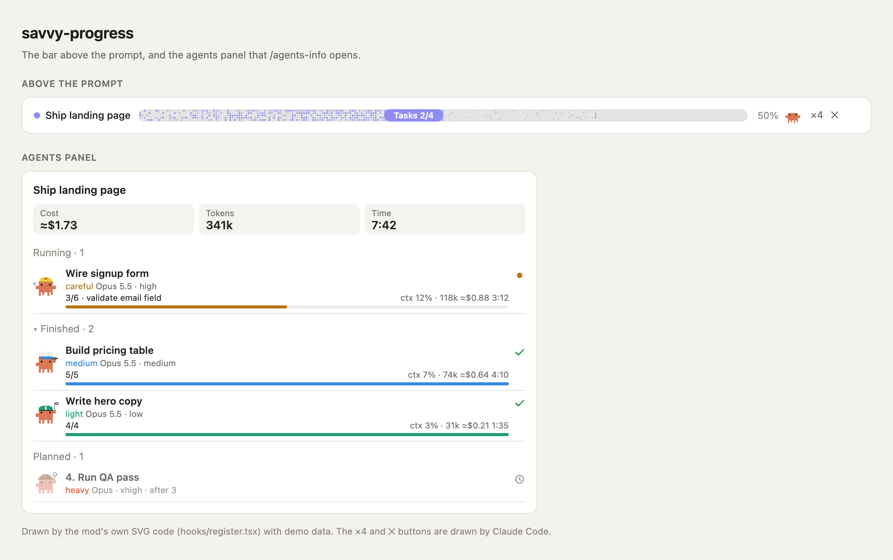
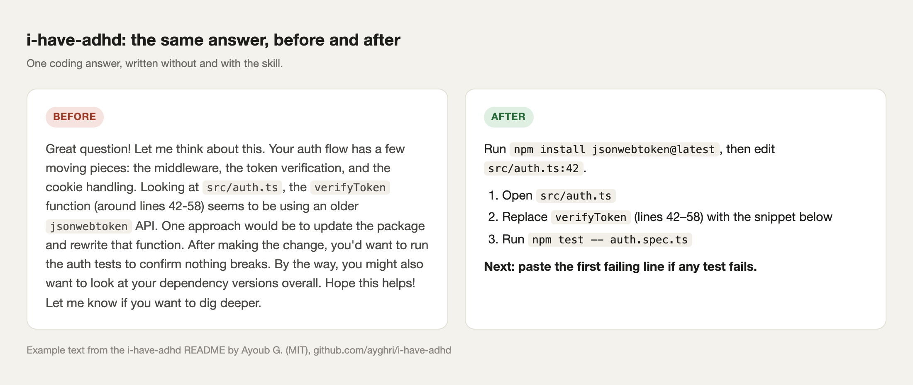

# claude-code-mods

The Claude Code mods I run every day, in one place.

This repository is a Claude Code **plugin marketplace**. It holds no mod code. Each entry installs straight from the original author's repository, pinned to the commit I tested. Credit and licenses stay with the authors.

| Mod | Author | What it is |
|---|---|---|
| [skins](#skins) | hellosverre | A new look for the whole transcript |
| [savvy-progress](#savvy-progress) | johnnyvizz | A progress bar and a live subagents panel |
| [filetree](#filetree) | Kurt Buhler | A file tree pane that shows what Claude touches |
| [i-have-adhd](#i-have-adhd) | Ayoub G. | Short, action-first replies |

Pictures for skins and filetree come from their authors' repositories. The i-have-adhd picture uses the example from its README. The savvy-progress picture is drawn by that mod's own SVG code with demo data.

## Requirements

- Claude Code **2.1.287 or later**. Mods do not load on older versions. Check with `claude --version`.
- A terminal, or the desktop app's Code tab. Mods do not load in WSL sessions of the desktop app.

## Install

Add this marketplace once:

```bash
claude plugin marketplace add ydarwish1/claude-code-mods
```

Then install the mods you want:

```bash
claude plugin install skins@claude-code-mods
claude plugin install savvy-progress@claude-code-mods
claude plugin install filetree@claude-code-mods
claude plugin install i-have-adhd@claude-code-mods
```

Inside a Claude Code session, use the same commands with a slash: `/plugin marketplace add ydarwish1/claude-code-mods`, then `/plugin install skins@claude-code-mods`.

Restart Claude Code after you install. Mods load at startup.

## The mods

### skins

**What it is:** a mod that redraws Claude Code's transcript.


<picture>
  <source media="(prefers-color-scheme: light)" srcset="https://raw.githubusercontent.com/hellosverre/claude-skins/342fbc0dd49ec44c824ed9c8eb95cd4927d7f81a/docs/previews/hero-light.svg">
  
</picture>

**What it does:**
- Tool calls get an icon, a spinner while they run, lines changed and time taken.
- Edits show as diff cards with green and red lines.
- Shell output shows in a terminal card with a Copy button.
- Tables and code blocks in replies show as cards with Copy buttons.
- The spinner shows what Claude is doing: thinking, running a tool, writing or waiting.
- A band above the prompt shows context use and plan limits, with a Compact button.
- Seven skins, light and dark. `/skin` switches them live. The `skin-designer` skill makes a new skin with you.

It only changes what is drawn. Your stored conversation does not change.

Source: [hellosverre/claude-skins](https://github.com/hellosverre/claude-skins) · MIT

### savvy-progress

**What it is:** a mod that shows progress and subagents.



**What it does:**
- A progress bar above the prompt: the task title, the phase, and accepted tasks out of planned.
- `/agents-info` opens a panel of running, finished and planned subagents. Each row shows model, effort, task progress, context, estimated cost and time.
- It adds two tools that agents call to report progress: `progress` (the lead agent) and `step` (a worker).

It was made for the `savvy-flow` skill in the same repository, but it shows any subagents. Cost is an estimate from token counts, not a bill.

Setting: `language` is `auto`, `en` or `ru`.

Source: [johnnyvizz/claude-kit](https://github.com/johnnyvizz/claude-kit/tree/main/plugins/savvy-progress) · MIT

### filetree

**What it is:** a mod that adds an IDE-style file tree pane.


**What it does:**
- Shows the working folder as a tree. `/filetree <path>` pins another folder.
- Shows git status per file and folder, and exact lines changed (`+N -N`).
- Shows branch and ahead/behind in the header.
- Files shimmer when Claude reads them (purple), writes them (orange) or commits them (green).
- The file you select is sent to Claude as context with your next prompt.

The pane sits in the right sidebar. In a terminal it needs the fullscreen layout (`/tui fullscreen`) and a window at least 110 columns wide.

Source: [data-goblin/claude-code-filetree](https://github.com/data-goblin/claude-code-filetree) · MIT

### i-have-adhd

**What it is:** a skill plugin, not a strict mod. It changes how Claude writes, not how Claude Code looks.



**What it does:**
- The next action comes first.
- Steps are numbered.
- Tangents, preamble and closers are cut.
- Lists stop at 5 items.
- Each reply ends with one concrete next step.

Type `/i-have-adhd` to turn it on. To turn it on in every session, run `touch ~/.claude/.i-have-adhd-always`.

Source: [ayghri/i-have-adhd](https://github.com/ayghri/i-have-adhd) · MIT

## For an AI agent reading this

If a user asks you to install these mods, do this:

1. Run `claude --version`. If it is lower than 2.1.287, stop and tell the user to update Claude Code first.
2. Run `claude plugin marketplace add ydarwish1/claude-code-mods`.
3. Ask the user which mods they want, unless they said "all". The names are `skins`, `savvy-progress`, `filetree` and `i-have-adhd`.
4. Run `claude plugin install <name>@claude-code-mods` for each one.
5. If the user already has a mod from its original marketplace (for example `skins@hellosverre-mods`), do not install it again from here. Two copies of one mod can both load. Check with `claude plugin list`.
6. Tell the user to restart Claude Code.
7. For `filetree` in a terminal, tell the user to run `/tui fullscreen` and use a window at least 110 columns wide.

To remove a mod: `claude plugin uninstall <name>@claude-code-mods`.

## Versions

Each mod is pinned to a commit I tested. You do not get new upstream versions until I move the pin. For the newest version, install from the author's own marketplace (see each mod's source link).

## License

The files in this repository are MIT. Each mod keeps its own license in its own repository.
